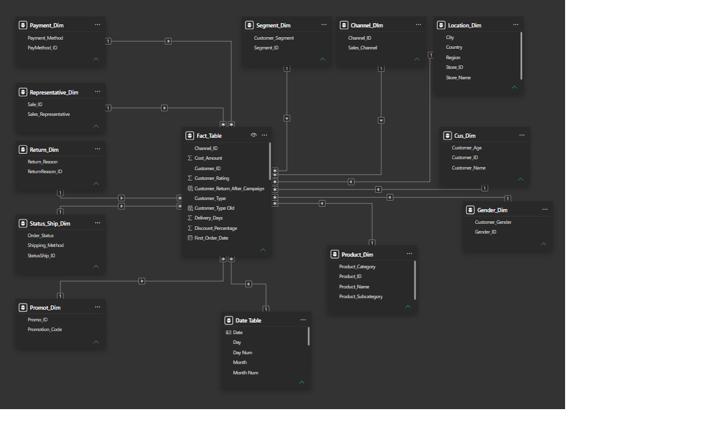
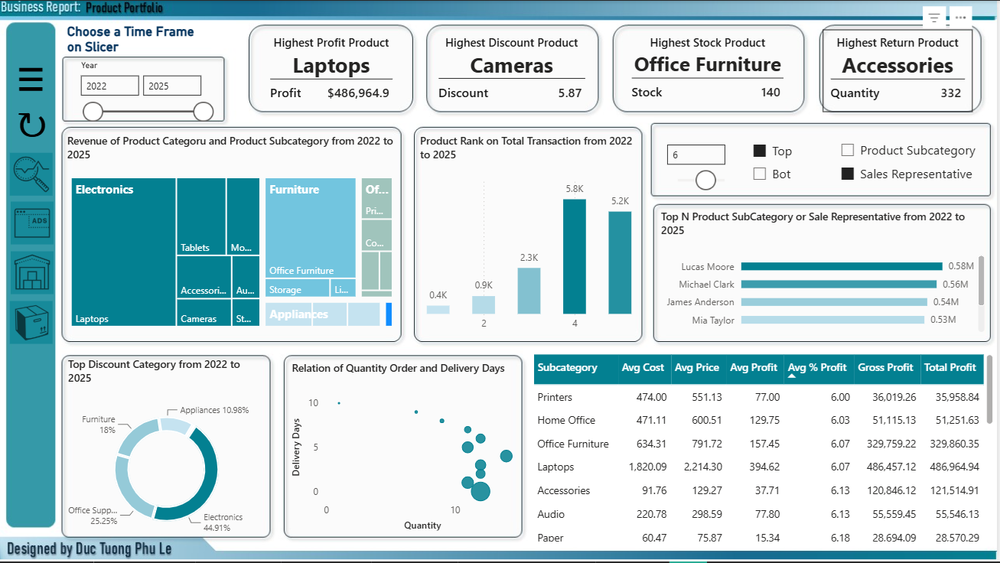

# 📊 End-to-End Business Performance & Growth Analytics (Power BI)

---

## 📌 Project Overview
This project delivers an Business Intelligence solution built in **Microsoft Power BI**. Designed to support executive decision-making, the dashboard evaluates operational health, unit economics, and growth drivers across **four core business pillars**:
1. **Sales Performance:** Revenue momentum, YoY/MoM growth trends, and top-performing sales representatives/channels.
2. **Marketing Campaign Effectiveness:** Customer acquisition efficiency (ROAS/POAS), transaction profitability, and post-campaign customer retention cohorts.
3. **Inventory & Stock Management:** Stock on-hand valuation, liquidity, and annual inventory turnover benchmarks.
4. **Product Portfolio Optimization:** SKU-level profitability, category contribution, and top-performing product rankings.

---

## Data Modeling & ETL Pipeline (Power Query)
To ensure fast query execution, eliminate bi-directional filtering ambiguity, and support accurate time-intelligence calculations, raw flat tables were normalized into a strict **Star Schema**:

* **Table Normalization (Duplicate & Distinct Keys):** Duplicated raw flat sheets in Power Query to isolate descriptive attributes from transactional records, applying column-specific deduplication (`Table.Distinct` on primary ID keys) to guarantee clean `1:*` cardinality.
* **Star Schema Architecture:** Built a central **`Fact_Table`** connected via single-direction, one-to-many (`1:*`) relationships to dedicated Dimension tables:
  * **Core Dimensions:** `Product_Dim`, `Cus_Dim`, `Location_Dim`, `Channel_Dim`, `Representative_Dim`
  * **Marketing & Order Dimensions:** `Promot_Dim`, `Segment_Dim`, `Gender_Dim`, `Payment_Dim`, `Status_Ship_Dim`, `Return_Dim`
* **Dedicated Date Table:** Created a continuous standalone **`Date Table`** marked as the official Date Table to power seamless **YoY** and **MoM** time-intelligence metrics.

---

## Key DAX Measures & Analytical Pillars

### 1. Sales & Product Portfolio Analytics
* **Time Intelligence:** `YoY Growth %` and `MoM Growth %` to separate organic growth from seasonal fluctuations.
* **Dynamic Top-N Filtering (`TOPN` / `RANKX`):** Isolates **Top-Performing Products** and **Top Sales Contributors** to highlight primary revenue and profit drivers.

### 2. Marketing Campaign & Customer Lifecycle Analytics
* **Unit Economics & Spend Efficiency:**
  * `Avg Profit / Transaction`: Tracks net profitability generated per order after product and discount/campaign costs.
  * `Cost per Transaction`: Evaluates acquisition and operational cost efficiency per order.
  * `Return on Spend (ROAS)` & `Profit on Spend (POAS)`: Compares gross revenue vs. actual net profit returned per dollar of marketing spend.
* **Customer Retention & Cohort Segmentation:**
  * **New vs. Returning Customers:** Segments first-time buyers against repeat purchasers based on `First_Order_Date`.
  * **One-Time Buyers vs. Retained Loyalists:** Measures post-campaign retention (`Customer_Return_After_Campaign`) to distinguish sustainable customer acquisition from one-off discount hunters.

### 3. Inventory & Stock Control Analytics
* **Stock Valuation & Volume:** Tracks real-time `Stock On-Hand` units and `Total Inventory Value` to monitor capital tied up in warehousing.
* **Turnover Efficiency:** Calculates `Inventory Turnover` alongside the `Annual Average Inventory Turnover` benchmark to evaluate stock velocity and liquidity.
* 

### 4. Product Portfolio Analytics
* **SKU Profitability & Margin Contribution:** Evaluates net profit and gross margin across product categories and subcategories (`Product_Dim`) to identify high-performing vs. margin-dilutive items.

---

## 💡 Strategic Business Value: What Do These Numbers Improve?

Rather than merely reporting historical figures, each metric group is engineered to drive concrete operational improvements:

| Business Pillar | Key Metrics | How It Improves Business |
| :--- | :--- | :--- |
| **Sales Performance** | Top Sales, YoY & MoM Growth | **Spotting Growth & Seasonality:** Quickly identifies winning sales channels/reps and highlights slow MoM periods early so teams can adjust targets on time. |
| **Marketing & Retention** | POAS, ROAS, Avg Profit/Txn, Cost/Txn, New vs. Returning, 1-Time vs. Repeat | **Smarter Ad Spend:** Focuses budget on campaigns that generate real net profit (POAS) and loyal repeat buyers, rather than one-time discount hunters. |
| **Inventory & Stock** | Stock On-Hand, Inventory Value, Inventory Turnover, Annual Avg Turnover | **Better Cash Flow:** Flags slow-moving stock for clearance promotions and alerts teams to restock bestsellers before they run out. |
| **Product Portfolio** | Top Products, Category Profit & Margin | **Sharper Product Focus:** Helps prioritize high-profit "star" products while cutting or repricing low-margin items. |

---
