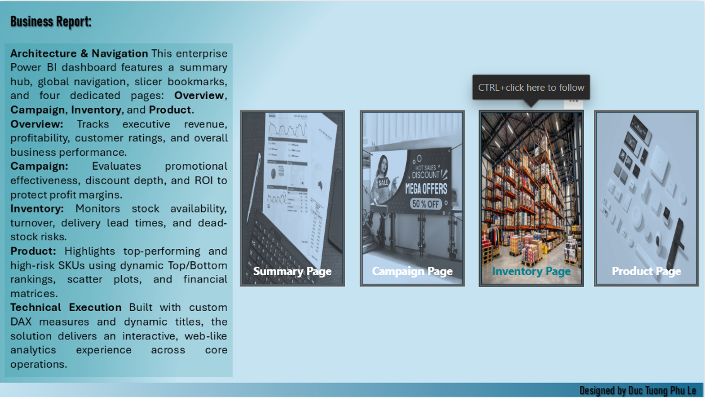
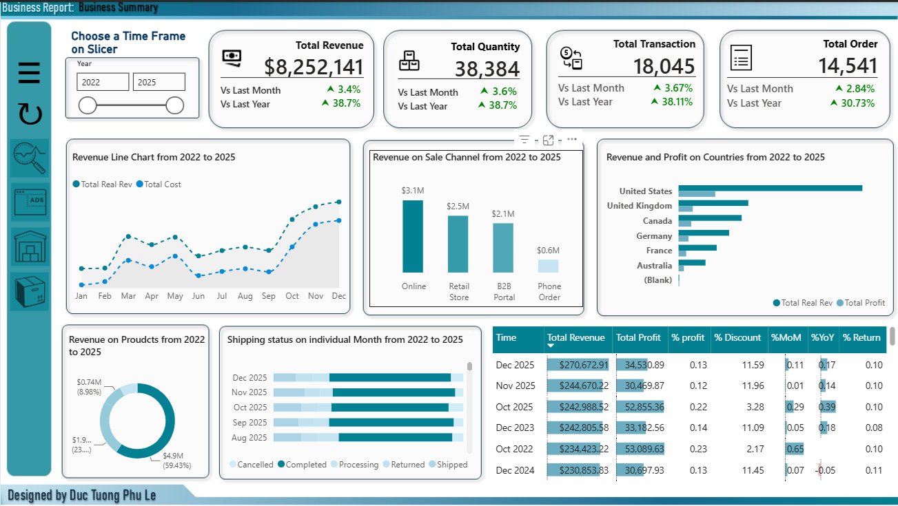
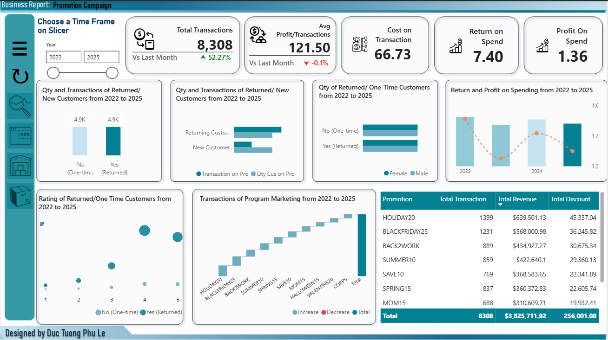
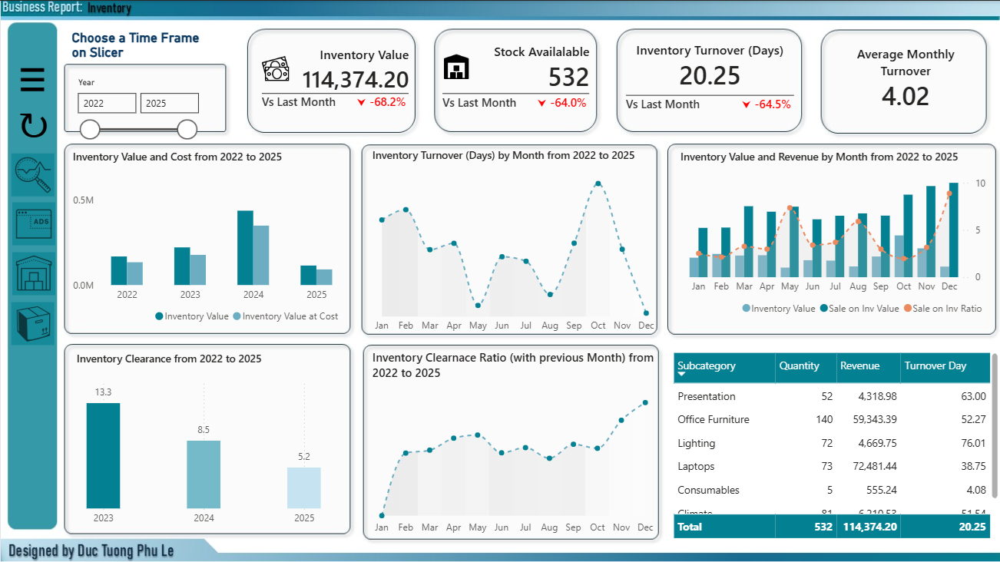

# 📊 End-to-End Business Performance & Growth Analytics (Power BI)

---

## 🎯 Project Goal & Key Business Questions

The objective of this project is to transform raw transactional data into an interactive Business Intelligence solution that empowers stakeholders to make data-driven decisions across sales, marketing, inventory, and product strategy.

### Core Business Questions Addressed
1. **Sales & Profitability Trends:** How are revenue and net profit performing over time (YoY and MoM), and what drives seasonal fluctuations?
2. **Product Portfolio Performance:** Which products and categories contribute the most to top-line revenue and bottom-line profit?
3. **Customer Value & Retention:** Which customer segments generate the highest lifetime value, and how effectively are we converting one-time buyers into repeat customers?
4. **Marketing & Campaign ROI:** How effective are promotional campaigns in generating true net profit (`POAS` / `ROAS`) rather than just discounted volume?
5. **Inventory Health & Velocity:** How efficiently is inventory turning over across SKUs, and where is working capital tied up in slow-moving stock?
6. **Strategic Growth Opportunities:** What actionable opportunities—such as reallocating ad spend, repricing low-margin SKUs, or optimizing reorder timing—can be uncovered from the data?

---
## 🎯 Project Outcomes
* Built a scalable Power BI reporting solution.
* Applied Star Schema data modeling principles.
* Developed reusable DAX measures.
* Delivered business-focused dashboards.
* Generated actionable insights for decision-making.
---
## Interactive Dashboard Features
* **Dynamic Cross-Filtering & Slicers:** Filter seamlessly across time periods (`Date Table`), product categories, sales channels, and customer segments.
* **Page Navigation & Drill-Downs:** Switch between Executive Summary, Marketing Campaigns, Inventory, and Product views, or drill down from category level to individual SKU performance.
* **Custom Tooltips:** Hover over key KPIs and trend lines to inspect secondary context (e.g., profit margin %, transaction counts, and prior-year benchmarks) without cluttering the main canvas.
---

---
## Data Modeling & ETL Pipeline (Power Query)

To ensure fast query execution, eliminate bi-directional filtering ambiguity, and support accurate time-intelligence calculations, raw flat tables were normalized into a strict **Star Schema**.
Data preparation was performed using **Power Query**.

### Transformation Steps
* Handled missing values
* Corrected data types
* Standardized column names
* Cleaned product and customer information
* Applied business rules for reporting
* **Table Normalization (Duplicate & Distinct Keys):** Duplicated raw flat sheets in Power Query to isolate descriptive attributes from transactional records, applying column-specific deduplication (`Table.Distinct` on primary ID keys) to guarantee clean `1:*` cardinality.
* **Star Schema Architecture:** Built a central **`Fact_Table`** connected via single-direction, one-to-many (`1:*`) relationships to dedicated Dimension tables
* **Dedicated Date Table:** Created a continuous standalone **`Date Table`** marked as the official Date Table to power seamless **YoY** and **MoM** time-intelligence metrics.

---

## Key DAX Measures & Analytical Pillars

### 1. Sales & Product Portfolio Analytics
* **Time Intelligence:** `YoY Growth %` and `MoM Growth %` to separate organic growth from seasonal fluctuations.
* **Dynamic Top-N Filtering (`TOPN` / `RANKX`):** Isolates **Top-Performing Products** and **Top Sales Contributors** to highlight primary revenue and profit drivers.

#### Sales Performance
* Revenue is concentrated in a small number of high-performing products.
* Several products generate strong sales but low profitability.
* Revenue and profit trends show seasonal behavior.
---
### 2. Marketing Campaign & Customer Lifecycle Analytics
* **Unit Economics & Spend Efficiency:**
  * `Avg Profit / Transaction`: Tracks net profitability generated per order after product and discount/campaign costs.
  * `Cost per Transaction`: Evaluates acquisition and operational cost efficiency per order.
  * `Return on Spend (ROAS)` & `Profit on Spend (POAS)`: Compares gross revenue vs. actual net profit returned per dollar of marketing spend.
* **Customer Retention & Cohort Segmentation:**
  * **New vs. Returning Customers:** Segments first-time buyers against repeat purchasers based on `First_Order_Date`.
  * **One-Time Buyers vs. Retained Loyalists:** Measures post-campaign retention (`Customer_Return_After_Campaign`) to distinguish sustainable customer acquisition from one-off discount hunters.

#### Campaign Performance
* Some campaigns generate high transaction volume but lower margins.
* Promotional effectiveness differs significantly by customer segment.

#### Customer Behavior
* A limited customer segment contributes the majority of sales.
* Returning customers generate higher profitability compared to new customers.
* Customer engagement varies across promotional campaigns.
---
  
### 3. Inventory & Stock Control Analytics
* **Stock Valuation & Volume:** Tracks real-time `Stock On-Hand` units and `Total Inventory Value` to monitor capital tied up in warehousing.
* **Turnover Efficiency:** Calculates `Inventory Turnover` alongside the `Annual Average Inventory Turnover` benchmark to evaluate stock velocity and liquidity.
  

#### Inventory Performance
* Certain products consistently maintain high inventory turnover.
* Some inventory categories carry excess stock and may require attention.
---  
### 4. Product Portfolio Analytics
* **SKU Profitability & Margin Contribution:** Evaluates net profit and gross margin across product categories and subcategories (`Product_Dim`) to identify high-performing vs. margin-dilutive items.

---

## 💡 Strategic Business Value: What Do These Numbers Improve?

Rather than merely reporting historical figures, each metric group is engineered to drive concrete operational improvements:

| Business Pillar | Key Metrics | How It Improves Business |
| :--- | :--- | :--- |
| **Sales Performance** | Top Sales, YoY & MoM Growth | **Spotting Growth & Seasonality:** Quickly identifies winning sales channels/reps and highlights slow MoM periods early so teams can adjust targets on time. |
| **Marketing & Retention** | POAS, ROAS, Avg Profit/Txn, Cost/Txn, New vs. Returning, 1-Time vs. Repeat | **Smarter Ad Spend:** Focuses budget on campaigns that generate real net profit (POAS) and loyal repeat buyers, rather than one-time discount hunters. |
| **Inventory & Stock** | Stock On-Hand, Inventory Value, Inventory Turnover, Annual Avg Turnover | **Better Cash Flow:** Flags slow-moving stock for clearance promotions and alerts teams to restock bestsellers before they run out. |
| **Product Portfolio** | Top Products, Category Profit & Margin | **Sharper Product Focus:** Helps prioritize high-profit "star" products while cutting or repricing low-margin items. |

---
## How to Explore This Project
* Download the `.pbix` file in this repository and open it in **Microsoft Power BI Desktop** to inspect the Power Query transformations, Star Schema relationships, and DAX measures.
